# QuikInvoice — Invoice & Payment Management System

[](https://nodejs.org/)
[](https://react.dev/)
[](https://expressjs.com/)
[](https://www.mysql.com/)
[](https://tailwindcss.com/)
[](https://jestjs.io/)

**QuikInvoice** is a full-stack billing and invoice management platform built with **React 19**, **Node.js/Express**, and **MySQL (InnoDB)**. It is designed for freelancers, consultancies, and small-to-medium businesses that require dependable invoice creation, tracking, and settlement without the overhead of enterprise ERP systems.

Unlike basic CRUD demo projects, QuikInvoice prioritizes **financial data integrity**, **pessimistic concurrency control**, **server-authoritative monetary arithmetic**, and **multi-tenant data isolation**.

> [!NOTE]
> **Scope Disclosure:** QuikInvoice is an independent invoicing and payment tracking system. It is not an officially certified accounting suite or government GST e-invoicing portal. It provides complete internal ledger tracking, streaming vector PDFs, and relational audit controls.

---

## Table of Contents

- [Application Screenshots](#application-screenshots)
- [Core Features](#core-features)
- [Engineering Highlights](#engineering-highlights)
  - [A. Concurrency-Safe Payment Processing](#a-concurrency-safe-payment-processing)
  - [B. Reliable Monetary Calculations](#b-reliable-monetary-calculations)
  - [C. Multi-User Data Isolation](#c-multi-user-data-isolation)
- [Technology Stack](#technology-stack)
- [System Architecture](#system-architecture)
- [Database Design](#database-design)
- [Invoice Lifecycle & State Machine](#invoice-lifecycle--state-machine)
- [API Overview](#api-overview)
- [Local Setup & Reproduction](#local-setup--reproduction)
- [Automated Testing](#automated-testing)
- [GitHub Actions CI Pipeline](#github-actions-ci-pipeline)
- [Engineering Decisions & Trade-offs](#engineering-decisions--trade-offs)
- [Current Scope & Limitations](#current-scope--limitations)
- [Project Directory Structure](#project-directory-structure)

---

## Application Screenshots

All screenshots below represent the live application running on seeded enterprise demonstration data (201 clients, 100 invoices, and realistic payment histories).

### 1. Landing Page
Modern marketing landing page featuring real-time architecture callouts, interactive preview cards, feature highlights, and FAQs.

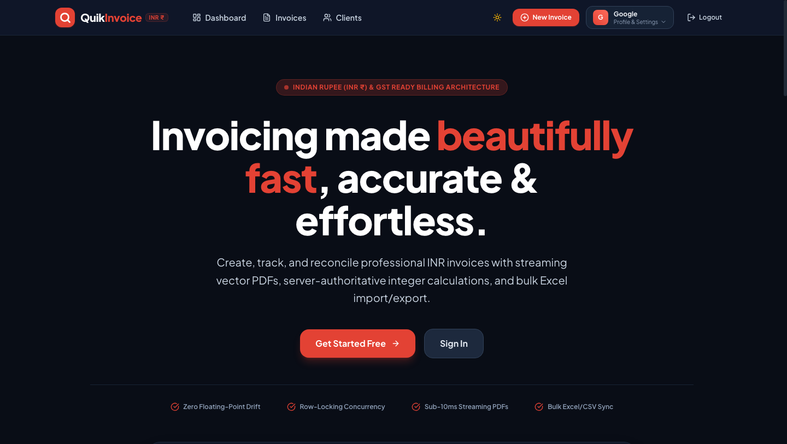

---

### 2. Financial Dashboard (Dark Theme)
Executive overview presenting real-time KPIs: Total Billed, Total Collected, Outstanding Balance Due, Overdue Delinquencies, Collection Efficiency, and Invoice Status distribution.

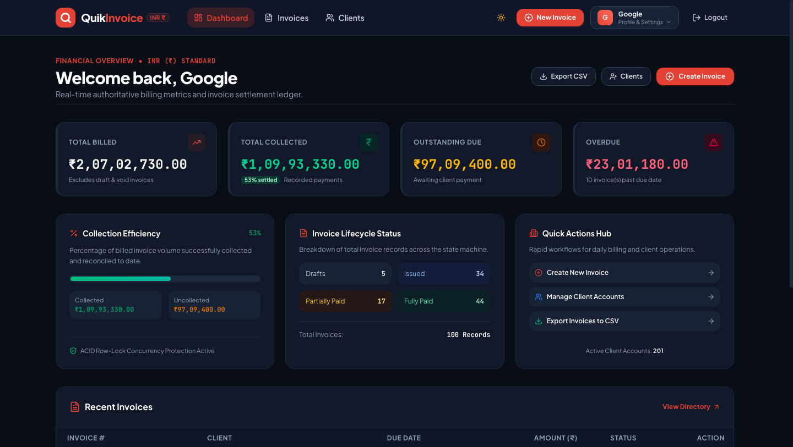

---

### 3. Clients Directory
Card-based client management directory with instant 300ms debounced search, active invoice count counters, and bulk CSV import/export capabilities.

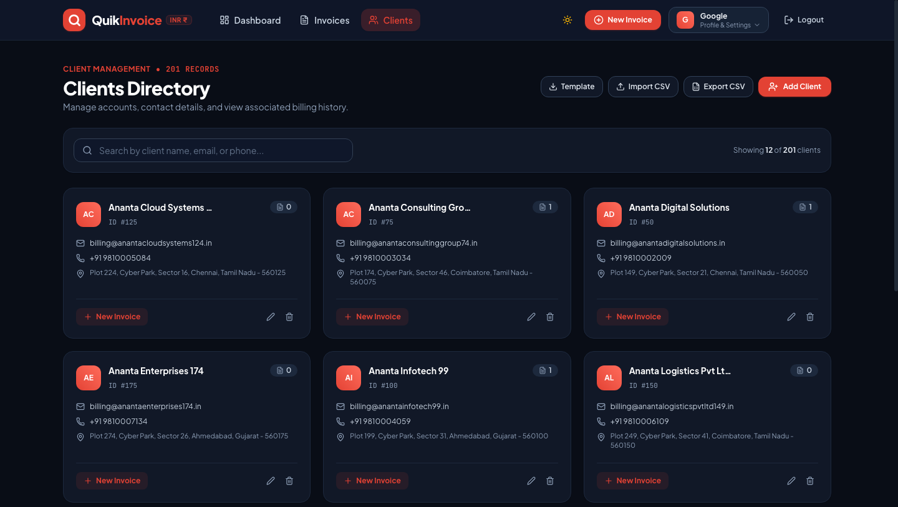

---

### 4. Invoices Ledger
Filterable billing ledger supporting status tabs (Draft, Issued, Partially Paid, Paid, Overdue, Void), search, and direct actions.

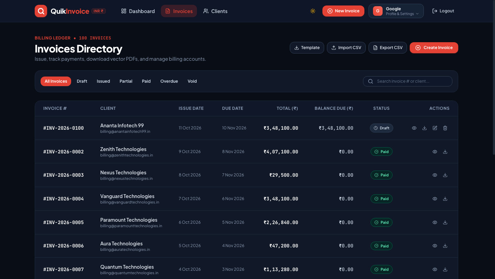

---

### 5. Invoice Creation Form
Interactive line item builder supporting fractional quantities, unit prices, itemized GST tax slabs, and real-time summary previews.

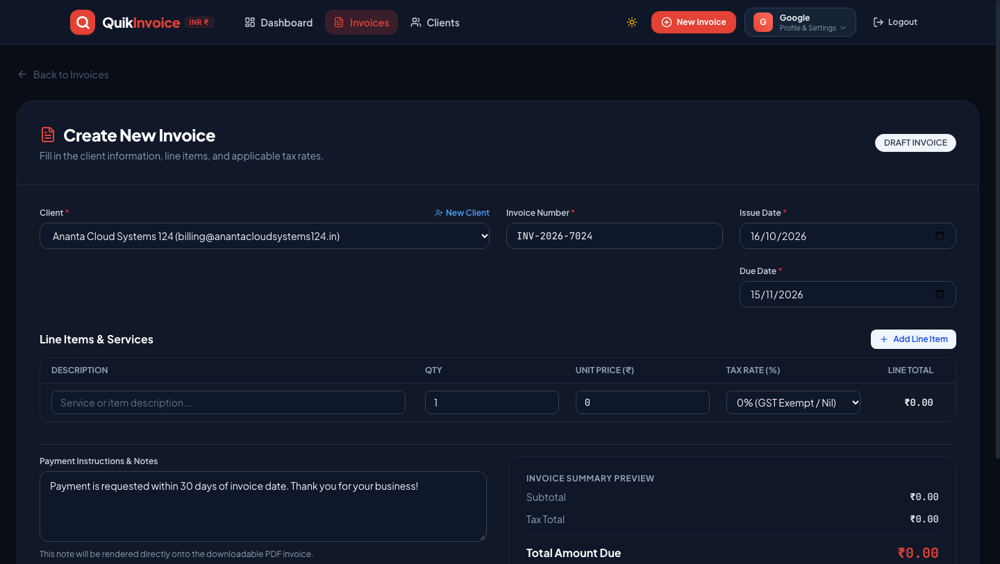

---

### 6. Invoice Details & Payment History
Complete invoice breakdown with settlement progress bar, itemization, immutable payment audit trail, and instant payment recording modal.

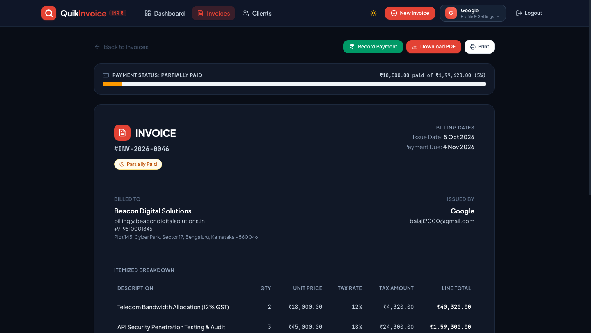

---

### 7. Light Theme View
Demonstrates accessible visual contrast, typography, and clean light-mode styling.

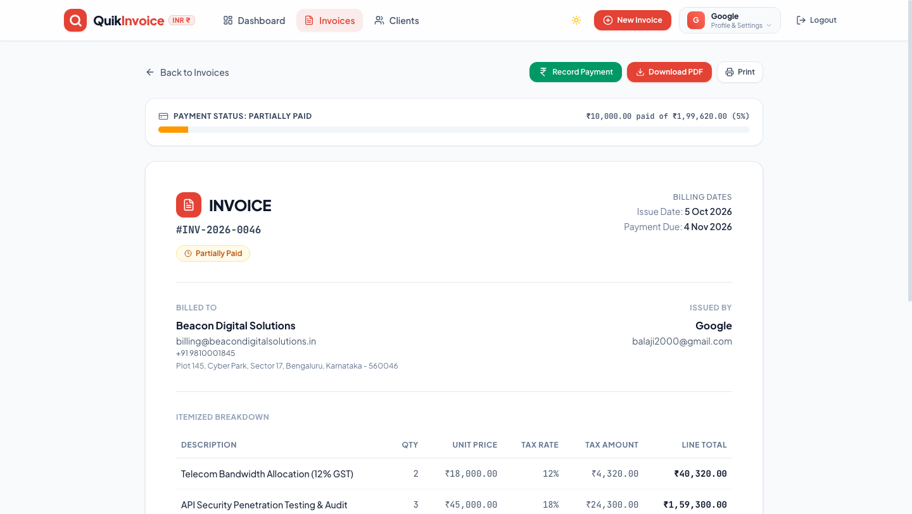

---

### 8. Streaming Vector PDF Invoice
Generated on-the-fly via PDFKit with sub-10ms response times, crisp typography, Indian Rupee (`₹`) formatting, and itemized payment history.

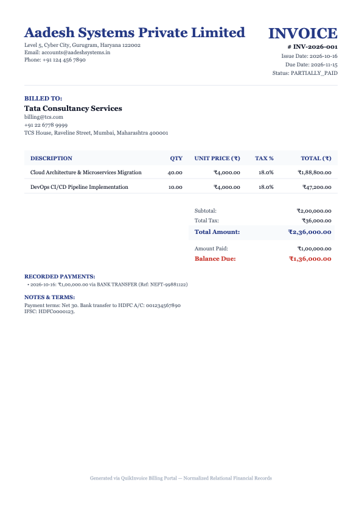

---

## Core Features

- **Authentication & Session Management:** Signed JWT stored in `httpOnly`, `SameSite=Lax` cookies with server-side instantaneous revocation via `token_version`.
- **Client Management:** Complete CRUD directory with name, email, phone, and billing address. Prevents accidental client deletion if invoices exist.
- **Invoice Creation & Lifecycle:** Structured state machine (`DRAFT`, `ISSUED`, `PARTIALLY_PAID`, `PAID`, `OVERDUE`, `VOID`) enforcing immutable accounting rules.
- **Indian Rupee (INR, ₹) Standardization:** Complete currency standardization across backend services, PDF engine, and frontend interfaces using Indian numbering conventions (lakhs and crores: `₹1,25,000.00`).
- **High-Performance Streaming Vector PDF:** Server-side PDF generation using `PDFKit` streaming directly to HTTP response streams with zero disk I/O and ~6ms average latency.
- **Partial & Full Payments:** Support for recording arbitrary partial or full payments with real-time settlement progress tracking.
- **Payment History Ledger:** Permanent ledger records with payment date, method, reference numbers, and notes.
- **Ephemeral Overdue Handling:** Dynamically evaluates overdue invoices in SQL queries (`due_date < CURRENT_DATE() AND amount_due > 0`) eliminating cron job desynchronization.
- **Dashboard Financial Metrics:** Instant aggregations for Billed, Collected, Outstanding, and Overdue volumes.
- **Bulk CSV / Excel Operations:** One-click CSV template download, client/invoice export, and CSV import with formula injection (CWE-1236) sanitization.
- **Search Debouncing:** 300ms debounce across client and invoice queries to minimize unnecessary database roundtrips.
- **Dark & Light Mode:** Seamless theme toggle with persistent user preference and smooth CSS color transitions.

---

## Engineering Highlights

### A. Concurrency-Safe Payment Processing

In commercial billing software, payment race conditions are a critical failure mode. When an invoice has an outstanding balance of **₹600.00**, two simultaneous payment requests of **₹500.00** each (e.g. from rapid double-clicks, webhook retries, or concurrent users) could both read the balance as ₹600.00 and proceed to record ₹1,000.00 against a ₹600.00 invoice.

#### Why a Normal Balance Check Fails
Under MySQL's default `REPEATABLE READ` transaction isolation level, standard non-locking `SELECT` queries execute snapshot reads via Multi-Version Concurrency Control (MVCC). A concurrent transaction does not see uncommitted or newly committed writes from another transaction, creating a **Time-of-Check to Time-of-Use (TOCTOU)** race window.

#### How QuikInvoice Prevents Overpayment
QuikInvoice wraps payment processing in an atomic MySQL transaction using **pessimistic row-level exclusive locking** (`SELECT ... FOR UPDATE`):

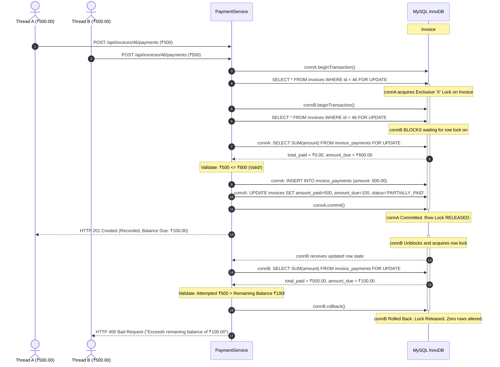

#### Code & Test Verification:
- **Service Implementation:** [`server/src/services/paymentService.js`](file:///Users/balajiaadesh/Desktop/projects/QuikInvoice/server/src/services/paymentService.js)
- **Concurrency Test Suite:** [`server/tests/payment.test.js`](file:///Users/balajiaadesh/Desktop/projects/QuikInvoice/server/tests/payment.test.js)
  - Test: `should prevent concurrent overpayment race conditions via row-level locking (SELECT ... FOR UPDATE)`
  - Under `Promise.all` with three simultaneous ₹500 payments on a ₹600 invoice, exactly one transaction succeeds (201 Created) and two fail (400 Bad Request). Exactly ₹500.00 is recorded.

> [!NOTE]
> **Boundary:** Row-level locks strictly serialize concurrent writes within the database instance. They do not represent distributed consensus locks across multi-region databases or idempotency keys for identical retry payloads.

---

### B. Reliable Monetary Calculations

JavaScript's native IEEE-754 double-precision binary floating-point representation causes arithmetic drift in financial operations (e.g. `0.1 + 0.2 === 0.30000000000000004`). In a billing system, accumulating floating-point values leads to penny discrepancies, unbalanced ledgers, and audit failures.

#### Calculation Design Principles
1. **Integer Paise Representation:** All monetary totals are converted to integer paise (`1 Rupee = 100 Paise`) before addition or subtraction (`toCents(rupees)` and `fromCents(paise)`).
2. **Half-Up Commercial Rounding:** Fractional values of 0.5 paise or greater round away from zero using `Number.EPSILON` to prevent binary floating-point edge-case truncation.
3. **Line-Level Rounding:** Each line item calculates `line_subtotal` and `line_tax` rounded to 2 decimal places before summing into invoice totals, ensuring line items mathematically add up to the displayed total.
4. **Server-Authoritative Invariance:** The server recalculates every line item and total from base inputs (`quantity`, `unit_price`, `tax_rate`). Any totals submitted by the browser client are explicitly discarded.

#### Code & Test Verification:
- **Money Utility:** [`server/src/utils/money.js`](file:///Users/balajiaadesh/Desktop/projects/QuikInvoice/server/src/utils/money.js)
- **Financial Test Suite:** [`server/tests/money.test.js`](file:///Users/balajiaadesh/Desktop/projects/QuikInvoice/server/tests/money.test.js) (20 passing tests covering fractional quantities, multi-slab tax rounding, integer limits, and Indian digit grouping).

---

### C. Multi-User Data Isolation

QuikInvoice operates on a shared-database multi-tenant model with strict row-level tenant isolation.

#### Isolation Mechanisms:
1. **Authentication:** The `requireAuth` middleware verifies the signed JWT from the `httpOnly` cookie and retrieves the verified tenant identity (`req.user`).
2. **Mandatory Query Scoping:** Every SQL query binds `WHERE user_id = ?` using `req.user.id`. No controller or model allows querying without tenant scoping.
3. **Ownership Verification & Enumeration Defense:** When fetching a resource by ID (`GET /api/invoices/:id`), the database query checks `WHERE id = ? AND user_id = ?`. If User B requests User A's invoice, the system returns `404 Not Found` rather than `403 Forbidden`, preventing resource enumeration.
4. **Relational Deletion Restrictions:** Foreign key constraints (`ON DELETE RESTRICT`) ensure that User A cannot delete clients or invoices that have active downstream financial dependencies.

#### Code & Test Verification:
- **Auth Middleware:** [`server/src/middlewares/authMiddleware.js`](file:///Users/balajiaadesh/Desktop/projects/QuikInvoice/server/src/middlewares/authMiddleware.js)
- **Isolation Tests:** [`server/tests/client.test.js`](file:///Users/balajiaadesh/Desktop/projects/QuikInvoice/server/tests/client.test.js) and [`server/tests/invoice.test.js`](file:///Users/balajiaadesh/Desktop/projects/QuikInvoice/server/tests/invoice.test.js) (verifying cross-tenant 404s on read, update, and delete).

---

## Technology Stack

| Layer | Technology | Version | Purpose |
| :--- | :--- | :--- | :--- |
| **Frontend Framework** | React | `^19.0.0` | Declarative component UI and reactive state |
| **Build Tool & Dev Server**| Vite | `^8.3.4` | Sub-second HMR and optimized production bundling |
| **Styling** | Tailwind CSS | `^4.0.0` | Responsive utility layout, CSS variables, dark theme |
| **Icons** | Lucide React | `^1.16.0` | Minimalist interface iconography |
| **Backend Framework** | Node.js / Express | `v20+` / `^4.21.2` | RESTful API server and request routing |
| **Database** | MySQL (InnoDB) | `8.0 / 9.5` | Relational storage, ACID transactions, row locking |
| **Database Client** | mysql2/promise | `^3.12.0` | Connection pooling and parameterized SQL execution |
| **PDF Generation** | PDFKit | `^0.16.0` | High-performance vector streaming PDF generation |
| **Authentication & Security**| bcryptjs / jsonwebtoken | `^3.0.2` / `^9.0.2` | Salted password hashing and signed JWT sessions |
| **HTTP Security** | Helmet / CORS | `^8.0.0` / `^2.8.5` | Security headers and origin allowlist controls |
| **Validation** | Zod | `^3.24.2` | Strict declarative request schema validation |
| **Test Runner** | Jest / Supertest | `^29.7.0` / `^7.0.0` | Integration and unit testing with native ES modules |

---

## System Architecture

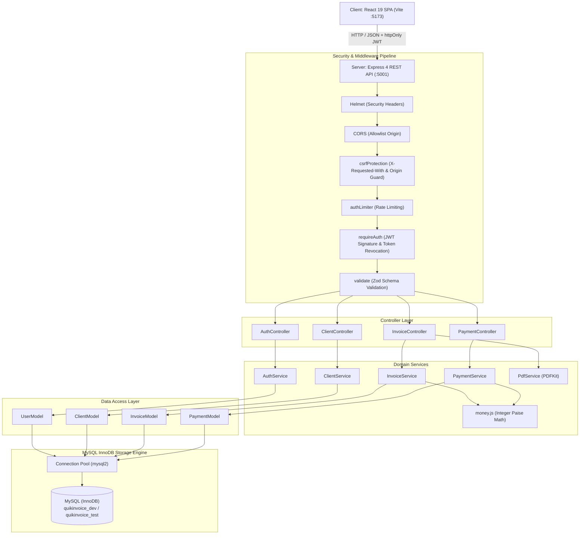

For full architectural specifications, see [`docs/ARCHITECTURE.md`](file:///Users/balajiaadesh/Desktop/projects/QuikInvoice/docs/ARCHITECTURE.md).

---

## Database Design

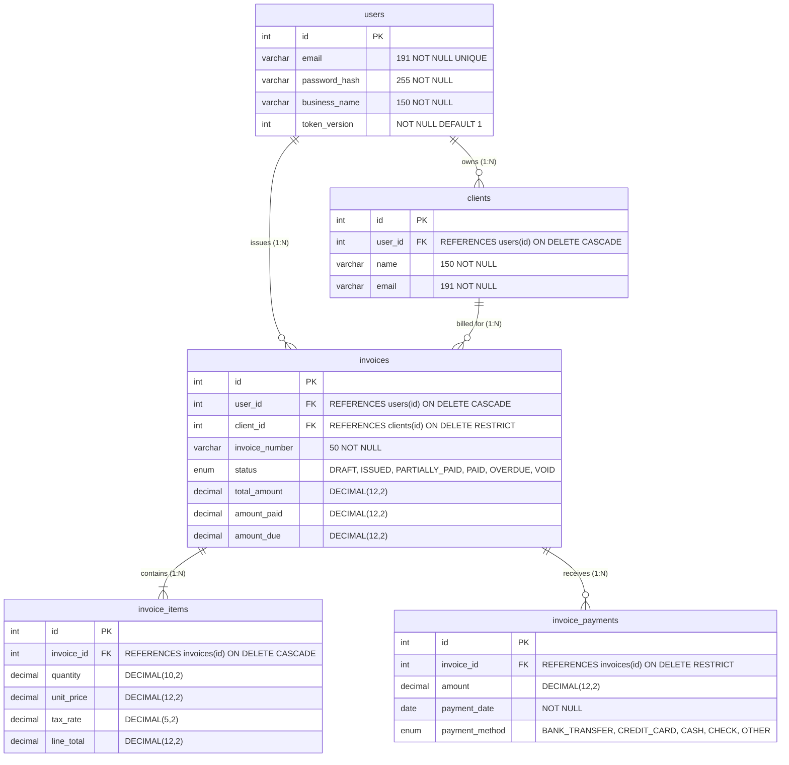

Detailed schema definitions, data types, indexes, and referential constraints are documented in [`docs/DATABASE-DESIGN.md`](file:///Users/balajiaadesh/Desktop/projects/QuikInvoice/docs/DATABASE-DESIGN.md).

---

## Invoice Lifecycle & State Machine

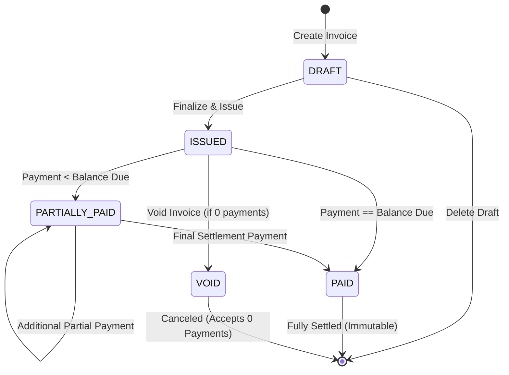

### Static Status vs Dynamic Overdue
In accounting systems, invoices cannot be modified or deleted once issued. QuikInvoice maintains this invariant:
- **Persistent Status:** Stored in `invoices.status` as `ISSUED`, `PARTIALLY_PAID`, or `PAID`.
- **Dynamic Overdue State:** Invoices are dynamically evaluated in SQL:
  ```sql
  (due_date < CURRENT_DATE() AND amount_due > 0 AND status NOT IN ('DRAFT', 'PAID', 'VOID')) AS is_overdue
  ```
  This eliminates cron job failures and guarantees real-time delinquent reporting.

---

## API Overview

All protected endpoints require an active session via `httpOnly` cookie or `Authorization: Bearer <token>`.

| Method | Endpoint | Description | Auth Required |
| :--- | :--- | :--- | :--- |
| `GET` | `/api/health` | Service and database connectivity health check | No |
| `POST` | `/api/auth/register` | Register new business tenant and set session cookie | No |
| `POST` | `/api/auth/login` | Authenticate tenant credentials and set session cookie | No |
| `GET` | `/api/auth/me` | Retrieve authenticated user profile | Yes |
| `POST` | `/api/auth/logout` | Revoke session (`token_version++`) and clear cookie | Yes |
| `GET` | `/api/clients` | List tenant clients with search & pagination | Yes |
| `POST` | `/api/clients` | Create new client profile | Yes |
| `GET` | `/api/clients/:id` | Fetch client details and invoice count | Yes |
| `PUT` | `/api/clients/:id` | Update client contact details | Yes |
| `DELETE`| `/api/clients/:id` | Delete client (fails with 409 if invoices exist) | Yes |
| `GET` | `/api/invoices` | List invoices with status, client, and search filters | Yes |
| `GET` | `/api/invoices/metrics` | Retrieve aggregate financial KPI metrics | Yes |
| `POST` | `/api/invoices` | Create invoice with normalized line items | Yes |
| `GET` | `/api/invoices/:id` | Retrieve invoice details, line items, and payments | Yes |
| `PUT` | `/api/invoices/:id` | Update draft invoice details | Yes |
| `PATCH` | `/api/invoices/:id/status` | Transition invoice state (e.g. DRAFT -> ISSUED) | Yes |
| `DELETE`| `/api/invoices/:id` | Delete draft invoice (rejected if issued or paid) | Yes |
| `POST` | `/api/invoices/:id/payments` | Record payment with pessimistic row locking | Yes |
| `GET` | `/api/invoices/:id/payments` | Retrieve chronological payment history ledger | Yes |
| `GET` | `/api/invoices/:id/pdf` | Stream vector PDF invoice directly to browser | Yes |

For full endpoint contracts and payload schemas, refer to [`docs/API-DOCUMENTATION.md`](file:///Users/balajiaadesh/Desktop/projects/QuikInvoice/docs/API-DOCUMENTATION.md).

---

## Local Setup & Reproduction

### Prerequisites
- **Node.js:** `v20.x` or `v22.x` / `v23.x`
- **MySQL Server:** `v8.0+` or `v9.x`
- **npm:** `v10.x+`

### 1. Clone Repository & Install Dependencies
```bash
git clone https://github.com/your-username/quikinvoice.git
cd quikinvoice

# Install server dependencies
npm --prefix server install

# Install client dependencies
npm --prefix client install
```

### 2. Configure Environment Variables
Copy the sanitized environment template:
```bash
cp server/.env.example server/.env
```

Verify the configuration in `server/.env`:
```ini
# Server Configuration (Port 5001 avoids macOS AirPlay collision on 5000)
PORT=5001
NODE_ENV=development

# Database Configuration (Development)
DB_HOST=127.0.0.1
DB_PORT=3306
DB_USER=root
DB_PASSWORD=your_mysql_password
DB_NAME=quikinvoice_dev

# Database Configuration (Testing)
DB_NAME_TEST=quikinvoice_test

# Authentication & Security
JWT_SECRET=replace_with_a_secure_random_secret_at_least_32_characters_long
JWT_EXPIRES_IN=24h
COOKIE_SECRET=replace_with_a_secure_cookie_signature_secret

# CORS & Client
CORS_ORIGIN=http://localhost:5173
```

### 3. Create Databases & Run Migrations
```bash
# Execute migrations against development database
npm run migrate

# (Optional) Seed realistic bulk demo data (201 clients, 100 invoices)
node server/src/db/seedBulkDemoData.js
```

### 4. Start the Application
In separate terminal windows (or via background tasks):

```bash
# Start backend API server (runs on http://localhost:5001)
npm run dev:server

# Start Vite frontend client (runs on http://localhost:5173)
npm run dev:client
```

Open your browser at **`http://localhost:5173`**.

---

## Automated Testing

QuikInvoice features an automated backend test suite with **86 unit, integration, and security tests** running across 6 test suites with zero external mocks.

```bash
# Run complete test suite against quikinvoice_test
npm test
```

### Verified Test Results (Final Run)
```
PASS tests/auth.test.js
PASS tests/security.test.js
PASS tests/money.test.js
PASS tests/client.test.js
PASS tests/invoice.test.js
PASS tests/payment.test.js

Test Suites: 6 passed, 6 total
Tests:       86 passed, 86 total
Snapshots:   0 total
Time:        52.426 s
```

### Test Suite Breakdown:
1. **`auth.test.js` (16 tests):** Registration, bcrypt hashing, duplicate email rejection, login, cookie setting, session verification, logout.
2. **`security.test.js` (11 tests):** Origin allowlist enforcement, CSRF `X-Requested-With` header verification, server-side JWT invalidation via `token_version`.
3. **`client.test.js` (12 tests):** Multi-tenant isolation, pagination, search keyword filtering, referential integrity (`ON DELETE RESTRICT`).
4. **`invoice.test.js` (14 tests):** Invoice creation, line item calculations, state machine transitions, draft deletion guards, overdue filtering.
5. **`payment.test.js` (13 tests):** Partial payments, exact-balance settlements, overpayment rejections, `SELECT ... FOR UPDATE` concurrency race conditions.
6. **`money.test.js` (20 tests):** Integer paise conversions, Half-Up commercial rounding, fractional unit prices, Indian Rupee formatting.

### Production Frontend Build Verification:
```bash
npm run build:client
```
Output:
```
✓ 2004 modules transformed.
dist/index.html                   1.22 kB │ gzip:   0.70 kB
dist/assets/index-B8ZFWjLg.css   65.32 kB │ gzip:  10.76 kB
dist/assets/index-DgPLe1Dr.js   488.63 kB │ gzip: 135.01 kB
✓ built in 466ms
```

---

## GitHub Actions CI Pipeline

The project includes an automated continuous integration pipeline configured in [`.github/workflows/ci.yml`](file:///.github/workflows/ci.yml):

```mermaid
graph LR
    Push[Push / Pull Request] --> Setup[Setup Node.js 20 LTS]
    Setup --> MySQL[Spin up MySQL 8.0 Service Container]
    MySQL --> HealthCheck[Wait for MySQL Healthcheck]
    HealthCheck --> Install[Install Dependencies via npm ci]
    Install --> Migrations[Run Migrations on quikinvoice_test]
    Migrations --> Jest[Execute Backend Tests - 86 Tests]
    Jest --> Build[Build Vite Production Bundle]
    Build --> Complete[CI Verified Success]
```

> [!NOTE]
> **CI Verification Status:** The GitHub Actions workflow is defined and validated locally. A remote passing badge will display once the repository is pushed to GitHub and executed by GitHub Actions runners.

---

## Engineering Decisions & Trade-offs

| Decision | Context | Trade-off Made | Full ADR |
| :--- | :--- | :--- | :--- |
| **MySQL InnoDB over NoSQL** | Financial data requires strict relational integrity, foreign keys, and ACID transactions. | Requires formal SQL migration scripts rather than dynamic schemaless documents. | [ADR-002](file:///docs/ENGINEERING-DECISIONS.md#adr-002) |
| **Row Locking (`FOR UPDATE`)** | Prevents concurrent overpayments without dropping database isolation level to SERIALIZABLE. | Holds an exclusive row-level mutex for the duration of the payment transaction (< 10ms). | [ADR-012](file:///docs/ENGINEERING-DECISIONS.md#adr-012) |
| **Server-Authoritative Math** | Eliminates binary floating-point drift and prevents client tampering. | Requires maintaining financial utility with integer paise math. | [ADR-011](file:///docs/ENGINEERING-DECISIONS.md#adr-011) |
| **`token_version` Revocation** | Provides instant server-side JWT session invalidation without Redis. | Requires a primary-key index lookup during authentication. | [ADR-006](file:///docs/ENGINEERING-DECISIONS.md#adr-006) |
| **Dynamic SQL Overdue** | Evaluates overdue state dynamically, eliminating scheduled cron job lag. | Overdue filtering queries evaluate date comparison against indexed column. | [ADR-014](file:///docs/ENGINEERING-DECISIONS.md#adr-014) |
| **Vector PDFKit Streaming** | Sub-10ms PDF generation directly to HTTP socket with zero disk I/O. | PDF layout coordinates are imperative rather than HTML/CSS. | [ADR-009](file:///docs/ENGINEERING-DECISIONS.md#adr-009) |

For comprehensive architectural decision records, consult [`docs/ENGINEERING-DECISIONS.md`](file:///Users/balajiaadesh/Desktop/projects/QuikInvoice/docs/ENGINEERING-DECISIONS.md).

---

## Current Scope & Limitations

### What Is Implemented:
- Full multi-tenant authentication with instant JWT revocation.
- Relational client directory with debounced search and deletion guards.
- Invoice builder with line-level taxes and server-authoritative calculations.
- Immutable state machine (`DRAFT`, `ISSUED`, `PARTIALLY_PAID`, `PAID`, `OVERDUE`, `VOID`).
- Concurrency-safe payment recording with `SELECT ... FOR UPDATE` row locks.
- Streaming vector PDF generation with Indian Rupee formatting.
- Financial dashboard metrics and bulk CSV import/export with formula injection guards.
- 86 automated backend integration and security tests.

### What Is Not Implemented (Future Roadmap):
- **Third-Party Payment Gateways:** Direct Stripe/Razorpay webhook callbacks (payments are currently recorded manually via the portal).
- **Government GST / E-Way Bill API:** Direct integration with India's Invoice Registration Portal (IRP).
- **Email Delivery:** Direct automated SMTP email dispatch of invoices to client email addresses.
- **Distributed Cloud Infrastructure:** Kubernetes clustering or distributed multi-region databases.

---

## Project Directory Structure

```
QuikInvoice/
├── .github/
│   └── workflows/
│       └── ci.yml                    # Automated CI workflow (MySQL 8 + Node 20)
├── client/                           # Frontend React 19 Application
│   ├── public/                       # Static assets & CSV sample templates
│   ├── src/
│   │   ├── api/                      # Axios HTTP client with anti-CSRF headers
│   │   ├── components/               # Navbar, modals, layout, and route guards
│   │   ├── context/                  # AuthContext and ThemeContext
│   │   ├── pages/                    # Landing, Dashboard, Invoices, Clients
│   │   └── utils/                    # Formatters, Indian Rupee, CSV parser
│   ├── package.json
│   └── vite.config.js                # Vite configuration with /api proxy (:5001)
├── docs/                             # Engineering Architecture & Audits
│   ├── assets/screenshots/           # High-resolution application screenshots
│   ├── audits/                       # Phase audit trails & implementation ledger
│   ├── API-DOCUMENTATION.md          # REST API endpoint specifications
│   ├── ARCHITECTURE.md               # System architecture and sequence flows
│   ├── DATABASE-DESIGN.md            # ER diagram, SQL schemas, and indexes
│   ├── ENGINEERING-DECISIONS.md      # Architectural Decision Records (ADRs)
│   └── PAYMENT-CONCURRENCY.md        # Row-level locking deep dive
├── server/                           # Backend Express Application
│   ├── src/
│   │   ├── config/                   # Database pool and environment parser
│   │   ├── controllers/              # Resource controllers (HTTP presentation)
│   │   ├── db/                       # Migration runner and SQL migrations (001-006)
│   │   ├── middlewares/              # Auth, CSRF, error handler, rate limiters
│   │   ├── models/                   # Parameterized SQL data access models
│   │   ├── routes/                   # Express route definitions
│   │   ├── services/                 # Business logic, payments, and PDFKit
│   │   ├── utils/                    # money.js (paise arithmetic) and errors
│   │   └── validations/              # Zod declarative request schemas
│   ├── tests/                        # 86 automated Jest integration tests
│   ├── package.json
│   └── server.js                     # HTTP server entrypoint
├── package.json                      # Root workspace scripts
└── README.md                         # Main repository portfolio documentation
```

---

## License

This project is open-source and available under the [MIT License](LICENSE).