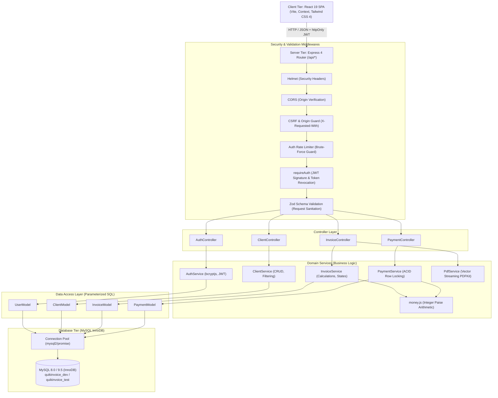
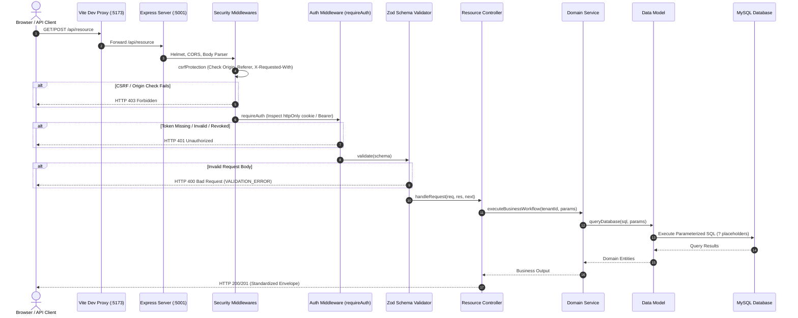
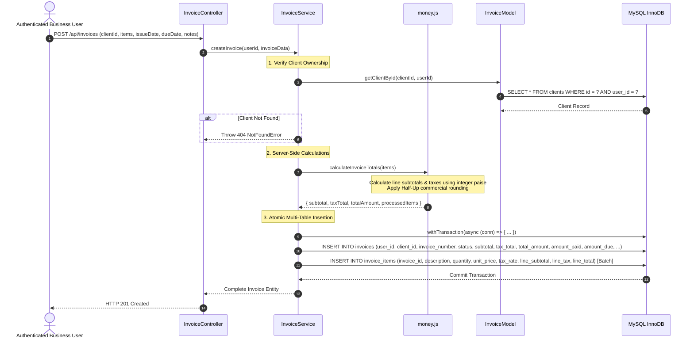
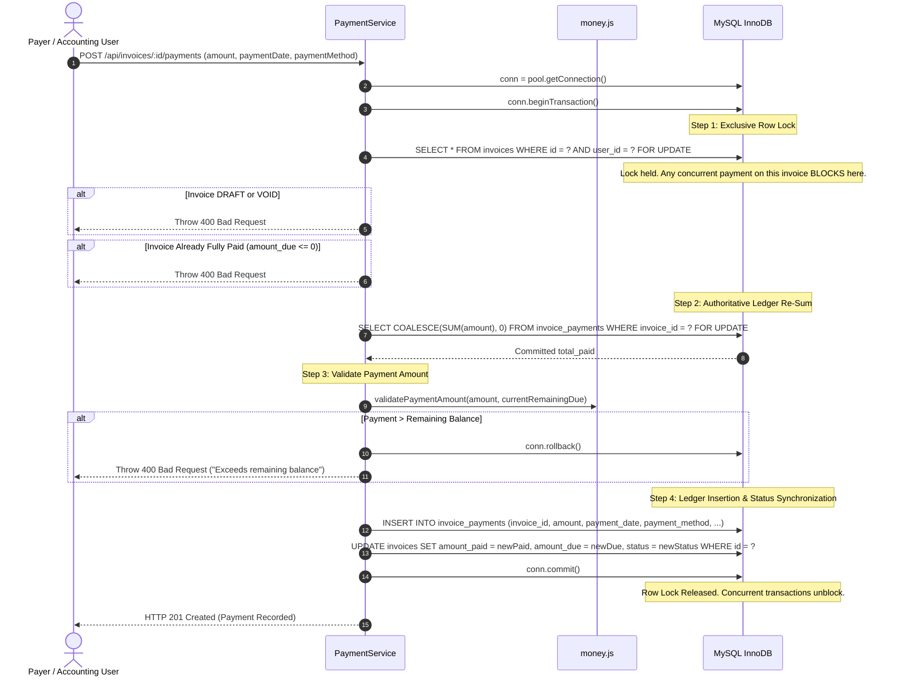
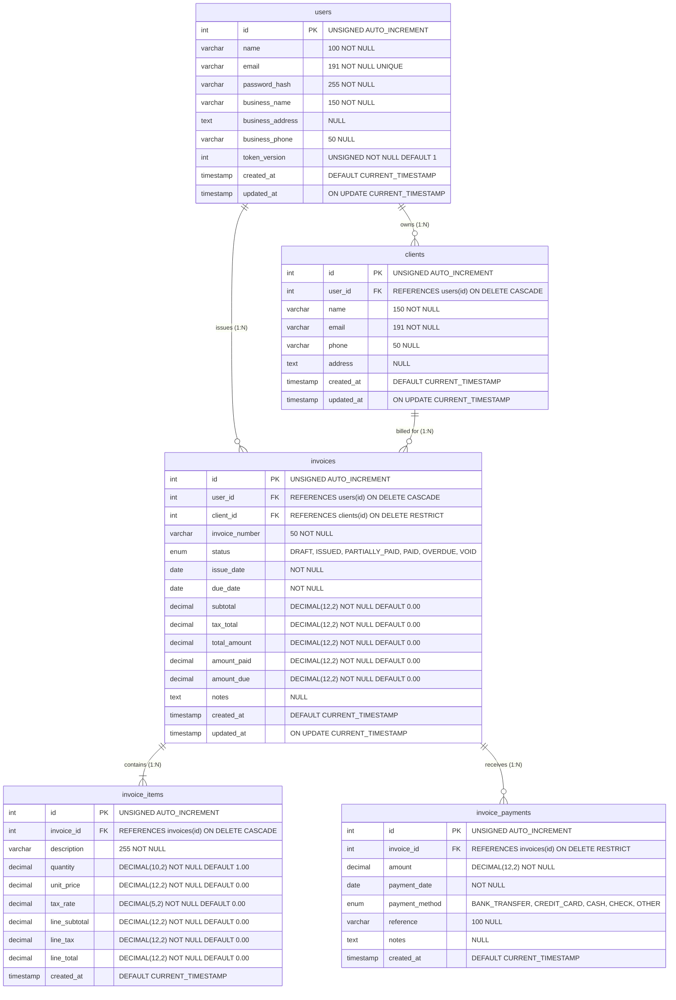
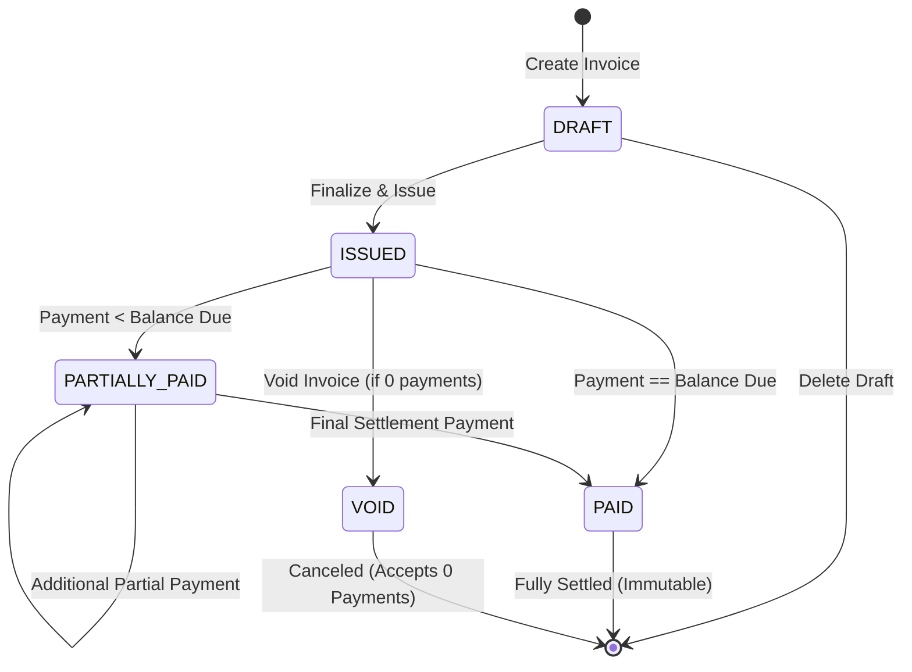

# QuikInvoice — System Architecture & Engineering Design

**Project:** QuikInvoice — Invoice & Payment Management System  
**Stack:** React 19, Vite 8, Tailwind CSS 4, Node.js 20+, Express.js 4, MySQL 8/9 (InnoDB)  
**Status:** Implemented & Fully Verified (86/86 Passing Automated Tests)  
**Date:** October 16, 2026  

---

## 1. Architectural Philosophy & Layered Separation

QuikInvoice is engineered to balance production-grade commercial reliability with clean, interview-defensible systems design. It rejects heavyweight ORM abstractions and unnecessary microservice complexity in favor of an explicit, decoupled multi-tier architecture with parameterized SQL, strict ACID transaction boundaries, and standard RESTful HTTP semantics.

### Layer Responsibilities



### Why This Separation Was Chosen:
1. **Controllers:** Strictly handle HTTP-level concerns: parsing request parameters, cookies, setting HTTP headers, and constructing standardized JSON response envelopes. Controllers contain zero SQL queries and zero business calculation logic.
2. **Services:** Contain pure, reusable domain business logic. Calculations (e.g. monetary line totals, tax rounding, overdue determination) and multi-table transactional workflows reside here.
3. **Models:** Encapsulate database access. Every query uses parameterized SQL (`?` placeholders) executed via `mysql2/promise`. Models ensure that database implementation details do not leak into business workflows.
4. **Authoritative Server Calculations:** All financial mathematics are executed exclusively on the server. Totals submitted by browser clients are completely discarded.

---

## 2. Request Lifecycle & Security Flow

### 2.1 Complete Request Lifecycle



---

## 3. Authentication & Authorization Architecture

### 3.1 Defense-in-Depth Authentication
1. **Password Hashing:** Uses `bcryptjs` with 12 salt rounds (~300ms computational cost per hash) to defend against offline GPU brute-force attacks.
2. **JWT Sessions via `httpOnly` Cookies:**
   - `httpOnly: true`: Browser JavaScript cannot read `document.cookie`, neutralizing XSS token theft.
   - `sameSite: 'lax'`: Mitigates Cross-Site Request Forgery (CSRF).
   - `secure: true`: Active in production to guarantee HTTPS-only transmission.
3. **Instant Token Revocation via `token_version`:**
   - Every user row has an unsigned integer `token_version`.
   - The token version is embedded inside the JWT payload `{ id, email, tokenVersion }`.
   - Upon logout or security revocation, `UPDATE users SET token_version = token_version + 1 WHERE id = ?` is executed.
   - The `requireAuth` middleware compares the token version in the JWT with the user's current version in MySQL. Any previously issued tokens are invalidated instantly across all browsers and devices without requiring Redis blacklists.

### 3.2 Tenant Isolation & Authorization
- **Shared Database, Separate Row Isolation:** Every database table (`clients`, `invoices`, `invoice_payments`) includes a `user_id` foreign key referencing `users.id`.
- **Enforced Query Scoping:** Every SQL `SELECT`, `UPDATE`, and `DELETE` query binds `WHERE user_id = ?` using the authenticated `req.user.id`.
- **Ownership Verification:** When accessing an invoice or client by ID (`/api/invoices/:id`), the query explicitly matches `WHERE id = ? AND user_id = ?`. If User B attempts to access User A's invoice, the system returns `404 Not Found` rather than leaking resource existence.

---

## 4. Invoice Creation Workflow



---

## 5. Payment Transaction & Concurrency Architecture

To eliminate overpayment race conditions caused by concurrent payments targeting the same invoice, payment processing acquires an exclusive pessimistic row lock via MySQL InnoDB's `SELECT ... FOR UPDATE`.



For full details, see [`docs/PAYMENT-CONCURRENCY.md`](file:///Users/balajiaadesh/Desktop/projects/QuikInvoice/docs/PAYMENT-CONCURRENCY.md).

---

## 6. Database Entity-Relationship Diagram



---

## 7. Invoicing State Machine & Dynamic Overdue Architecture



### Ephemeral Overdue Status (No Cron Jobs)
Instead of running fragile scheduled cron jobs that mutate database rows at midnight (which introduce time synchronization lag and database write contention), overdue status is **derived dynamically**:
```sql
(due_date < CURRENT_DATE() AND amount_due > 0 AND status NOT IN ('DRAFT', 'PAID', 'VOID')) AS is_overdue
```
This preserves persistent accounting statuses (`ISSUED` or `PARTIALLY_PAID`) while instantly surfacing overdue badges, filters, and metrics across the entire application in real time.

---

## 8. High-Performance Streaming Vector PDF Generation

Invoice PDF generation uses `PDFKit` to stream vector documents directly to Express HTTP response streams:
- **Zero Temporary Disk I/O:** The PDF is piped directly into `res` chunk-by-chunk (`doc.pipe(res)`).
- **Sub-10ms Latency:** Empirically benchmarked on macOS arm64 across multi-item invoices:
  - **Min:** 2.47 ms
  - **Max:** 28.66 ms
  - **Mean / Avg:** 5.95 ms
- **Typography & Currency:** Renders Indian Rupee currency (`₹`), client details, normalized line items, tax breakdowns, and payment history ledgers with clean typography.

---

## 9. Error Handling Contract

All application errors conform to a standardized RFC-7807 inspired contract:

```json
{
  "success": false,
  "error": {
    "message": "Validation failed",
    "code": "VALIDATION_ERROR",
    "details": [
      { "field": "dueDate", "message": "Due date cannot be earlier than issue date" }
    ]
  }
}
```

The global error handler maps:
| Exception / Error | HTTP Status | Error Code | Description |
| :--- | :--- | :--- | :--- |
| `ZodError` | `400 Bad Request` | `VALIDATION_ERROR` | Request body validation failed |
| `SyntaxError` | `400 Bad Request` | `INVALID_JSON` | Malformed JSON payload |
| `UnauthorizedError` | `401 Unauthorized` | `UNAUTHORIZED` | Missing, expired, or revoked token |
| `ForbiddenError` | `403 Forbidden` | `FORBIDDEN` | CSRF or origin verification failed |
| `NotFoundError` | `404 Not Found` | `NOT_FOUND` | Resource not found or belongs to another tenant |
| `ConflictError` / `ER_DUP_ENTRY` | `409 Conflict` | `CONFLICT` | Duplicate unique key (e.g. email, invoice number) |
| Internal Exception | `500 Internal Error` | `INTERNAL_SERVER_ERROR` | Unhandled error (sanitized in production) |

---

## 10. Design Trade-offs & Known Boundaries

| Decision | Alternative Considered | Selected Rationale | Trade-off / Limitation |
| :--- | :--- | :--- | :--- |
| **MySQL + InnoDB** | MongoDB / DynamoDB | Strict ACID transactions, foreign key constraints (`ON DELETE RESTRICT`), relational integrity | Requires formal migration files and relational schema design |
| **Row Locking (`FOR UPDATE`)** | Optimistic Locking (`version` column) | Completely serializes concurrent payments; mathematically prevents overpayment | Holds a row-level mutex for the duration of the payment transaction (< 10ms) |
| **Integer Paise Arithmetic** | IEEE-754 Floating Point (`Number`) | Eliminates binary floating-point rounding drift in commercial invoicing | Requires converting between rupees and integer paise |
| **`token_version` Revocation** | Redis Blacklist | Eliminates Redis infrastructure sprawl; instant global session revocation | Requires a fast clustered primary key lookup during authentication |
| **Dynamic Overdue SQL** | Midnight Cron Job Worker | Zero cron failure modes; real-time accuracy down to the second | Queries filtering overdue invoices must evaluate the date comparison |
| **PDFKit Vector Streaming** | Puppeteer / Headless Chrome | 5.95ms avg latency; 8MB memory footprint vs 300MB Chrome binary | PDF layout coordinates are coded imperatively rather than with CSS flexbox |
