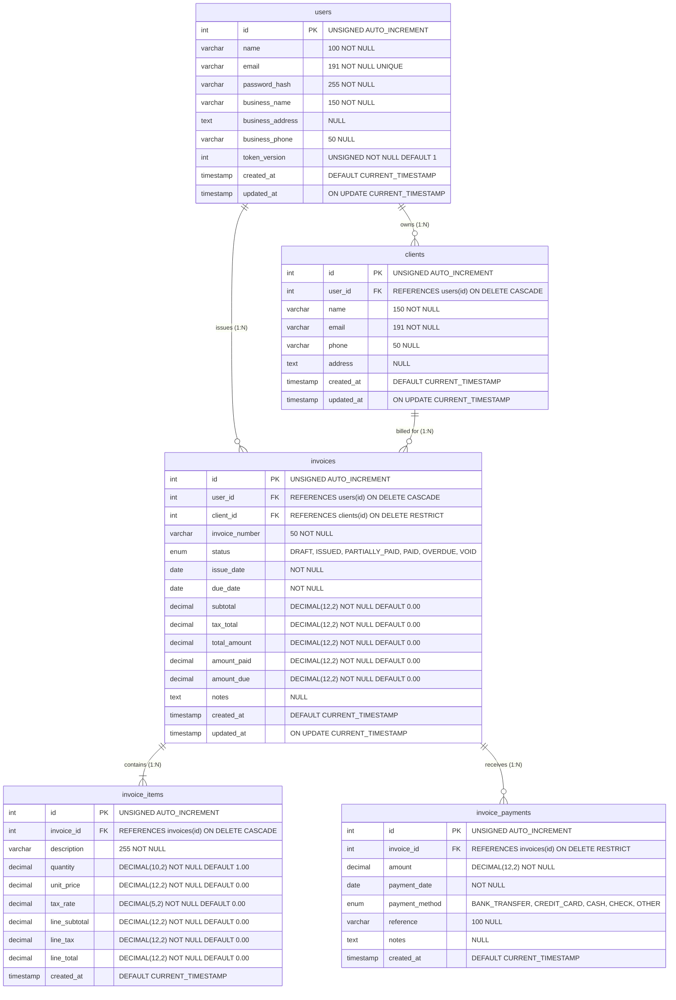

# QuikInvoice — Relational Database Design & Schema Documentation

**Project:** QuikInvoice — Invoice & Payment Management System  
**Storage Engine:** MySQL 8.0 / 9.5 (InnoDB)  
**Character Set:** `utf8mb4` | **Collation:** `utf8mb4_unicode_ci`  
**Migrations Runner:** `server/src/db/migrate.js`  
**Test Suite:** [`server/tests/client.test.js`](file:///Users/balajiaadesh/Desktop/projects/QuikInvoice/server/tests/client.test.js), [`server/tests/invoice.test.js`](file:///Users/balajiaadesh/Desktop/projects/QuikInvoice/server/tests/invoice.test.js), [`server/tests/payment.test.js`](file:///Users/balajiaadesh/Desktop/projects/QuikInvoice/server/tests/payment.test.js)  
**Status:** Verified (All 6 Migrations Applied)  
**Date:** October 16, 2026  

---

## 1. Relational Entity-Relationship Diagram (ERD)



---

## 2. Table Specifications & Migration History

### 2.1 `schema_migrations` (Migration Tracking Ledger)
Maintains an immutable record of all applied migrations.

```sql
CREATE TABLE IF NOT EXISTS schema_migrations (
    id INT UNSIGNED AUTO_INCREMENT PRIMARY KEY,
    migration_name VARCHAR(255) NOT NULL UNIQUE,
    applied_at TIMESTAMP DEFAULT CURRENT_TIMESTAMP
) ENGINE=InnoDB DEFAULT CHARSET=utf8mb4 COLLATE=utf8mb4_unicode_ci;
```

---

### 2.2 `users` (Tenants / Businesses)
Stores the business owners who issue invoices. Every business operates in strict multi-tenant isolation.
- **Migration:** `001_create_users.sql` + `002_add_user_token_version.sql`

```sql
CREATE TABLE IF NOT EXISTS users (
    id INT UNSIGNED AUTO_INCREMENT PRIMARY KEY,
    name VARCHAR(100) NOT NULL,
    email VARCHAR(191) NOT NULL UNIQUE,
    password_hash VARCHAR(255) NOT NULL,
    business_name VARCHAR(150) NOT NULL,
    business_address TEXT NULL,
    business_phone VARCHAR(50) NULL,
    token_version INT UNSIGNED NOT NULL DEFAULT 1,
    created_at TIMESTAMP DEFAULT CURRENT_TIMESTAMP,
    updated_at TIMESTAMP DEFAULT CURRENT_TIMESTAMP ON UPDATE CURRENT_TIMESTAMP,
    INDEX idx_users_email (email)
) ENGINE=InnoDB DEFAULT CHARSET=utf8mb4 COLLATE=utf8mb4_unicode_ci;
```

#### Key Design Decisions:
- **`email VARCHAR(191) UNIQUE`**: In `utf8mb4`, each character can consume up to 4 bytes. MySQL InnoDB index length limits (767 bytes in legacy, 3072 bytes in Barracuda) make `VARCHAR(191)` the standard safe length for indexed unique strings (`191 * 4 = 764 bytes`).
- **`token_version INT UNSIGNED DEFAULT 1`**: Enables instant server-side JWT session invalidation upon logout without requiring Redis or token blacklist tables.

---

### 2.3 `clients` (Customer Profiles)
Stores client and customer contact records owned by a specific tenant.
- **Migration:** `003_create_clients.sql`

```sql
CREATE TABLE IF NOT EXISTS clients (
    id INT UNSIGNED AUTO_INCREMENT PRIMARY KEY,
    user_id INT UNSIGNED NOT NULL,
    name VARCHAR(150) NOT NULL,
    email VARCHAR(191) NOT NULL,
    phone VARCHAR(50) NULL,
    address TEXT NULL,
    created_at TIMESTAMP DEFAULT CURRENT_TIMESTAMP,
    updated_at TIMESTAMP DEFAULT CURRENT_TIMESTAMP ON UPDATE CURRENT_TIMESTAMP,
    CONSTRAINT fk_clients_user FOREIGN KEY (user_id) REFERENCES users(id) ON DELETE CASCADE,
    INDEX idx_clients_user (user_id),
    INDEX idx_clients_email (user_id, email),
    INDEX idx_clients_name (user_id, name)
) ENGINE=InnoDB DEFAULT CHARSET=utf8mb4 COLLATE=utf8mb4_unicode_ci;
```

#### Key Design Decisions:
- **`CONSTRAINT fk_clients_user`**: Cascades on user deletion (`ON DELETE CASCADE`).
- **Compound Indexes (`idx_clients_email`, `idx_clients_name`)**: Because all queries are tenant-scoped, the leading column is `user_id`. This allows high-speed filtering and debounced searching by name or email within that specific tenant's client directory.

---

### 2.4 `invoices` (Billing Headers & State Machine)
Stores invoice documents with financial totals and state machine transitions.
- **Migration:** `004_create_invoices.sql`

```sql
CREATE TABLE IF NOT EXISTS invoices (
    id INT UNSIGNED AUTO_INCREMENT PRIMARY KEY,
    user_id INT UNSIGNED NOT NULL,
    client_id INT UNSIGNED NOT NULL,
    invoice_number VARCHAR(50) NOT NULL,
    status ENUM('DRAFT', 'ISSUED', 'PARTIALLY_PAID', 'PAID', 'OVERDUE', 'VOID') NOT NULL DEFAULT 'DRAFT',
    issue_date DATE NOT NULL,
    due_date DATE NOT NULL,
    subtotal DECIMAL(12, 2) NOT NULL DEFAULT 0.00,
    tax_total DECIMAL(12, 2) NOT NULL DEFAULT 0.00,
    total_amount DECIMAL(12, 2) NOT NULL DEFAULT 0.00,
    amount_paid DECIMAL(12, 2) NOT NULL DEFAULT 0.00,
    amount_due DECIMAL(12, 2) NOT NULL DEFAULT 0.00,
    notes TEXT NULL,
    created_at TIMESTAMP DEFAULT CURRENT_TIMESTAMP,
    updated_at TIMESTAMP DEFAULT CURRENT_TIMESTAMP ON UPDATE CURRENT_TIMESTAMP,
    CONSTRAINT fk_invoices_user FOREIGN KEY (user_id) REFERENCES users(id) ON DELETE CASCADE,
    CONSTRAINT fk_invoices_client FOREIGN KEY (client_id) REFERENCES clients(id) ON DELETE RESTRICT,
    UNIQUE KEY uq_user_invoice_number (user_id, invoice_number),
    INDEX idx_invoices_user_status (user_id, status),
    INDEX idx_invoices_client (client_id),
    INDEX idx_invoices_due_date (user_id, due_date)
) ENGINE=InnoDB DEFAULT CHARSET=utf8mb4 COLLATE=utf8mb4_unicode_ci;
```

#### Key Design Decisions:
- **`UNIQUE KEY uq_user_invoice_number (user_id, invoice_number)`**: Enforces invoice number uniqueness per business while allowing different businesses to independently use sequential numbers (e.g. `INV-2026-0001`).
- **`CONSTRAINT fk_invoices_client ON DELETE RESTRICT`**: Prevents deleting a client if invoices exist referencing that client, guaranteeing audit preservation.
- **Fixed-Point `DECIMAL(12, 2)`**: Supports monetary amounts up to ₹9,99,99,99,999.99 with exact precision.
- **Compound Indexes**: `idx_invoices_user_status` and `idx_invoices_due_date` ensure that dashboard KPI metrics and overdue filtering execute in sub-millisecond time.

---

### 2.5 `invoice_items` (Line Items & Itemized Taxes)
Stores normalized line items, quantities, unit prices, and line-level tax percentages.
- **Migration:** `005_create_invoice_items.sql`

```sql
CREATE TABLE IF NOT EXISTS invoice_items (
    id INT UNSIGNED AUTO_INCREMENT PRIMARY KEY,
    invoice_id INT UNSIGNED NOT NULL,
    description VARCHAR(255) NOT NULL,
    quantity DECIMAL(10, 2) NOT NULL DEFAULT 1.00,
    unit_price DECIMAL(12, 2) NOT NULL DEFAULT 0.00,
    tax_rate DECIMAL(5, 2) NOT NULL DEFAULT 0.00,
    line_subtotal DECIMAL(12, 2) NOT NULL DEFAULT 0.00,
    line_tax DECIMAL(12, 2) NOT NULL DEFAULT 0.00,
    line_total DECIMAL(12, 2) NOT NULL DEFAULT 0.00,
    created_at TIMESTAMP DEFAULT CURRENT_TIMESTAMP,
    CONSTRAINT fk_items_invoice FOREIGN KEY (invoice_id) REFERENCES invoices(id) ON DELETE CASCADE,
    INDEX idx_items_invoice (invoice_id)
) ENGINE=InnoDB DEFAULT CHARSET=utf8mb4 COLLATE=utf8mb4_unicode_ci;
```

#### Key Design Decisions:
- **Line-Level Taxes:** Tax percentages (`tax_rate DECIMAL(5, 2)`) are defined per item, supporting mixed GST slabs (e.g. 0%, 5%, 12%, 18%, 28%) on a single invoice.
- **`quantity DECIMAL(10, 2)`**: Supports fractional units (e.g. 2.5 consulting hours, 14.75 kg materials).
- **`ON DELETE CASCADE`**: When an invoice draft is deleted, its items are automatically cleaned up.

---

### 2.6 `invoice_payments` (Payment Ledger & Audit Trail)
Stores immutable payment records against issued invoices.
- **Migration:** `006_create_invoice_payments.sql`

```sql
CREATE TABLE IF NOT EXISTS invoice_payments (
    id INT UNSIGNED AUTO_INCREMENT PRIMARY KEY,
    invoice_id INT UNSIGNED NOT NULL,
    amount DECIMAL(12, 2) NOT NULL,
    payment_date DATE NOT NULL,
    payment_method ENUM('BANK_TRANSFER', 'CREDIT_CARD', 'CASH', 'CHECK', 'OTHER') NOT NULL,
    reference VARCHAR(100) NULL,
    notes TEXT NULL,
    created_at TIMESTAMP DEFAULT CURRENT_TIMESTAMP,
    CONSTRAINT fk_payments_invoice FOREIGN KEY (invoice_id) REFERENCES invoices(id) ON DELETE RESTRICT,
    INDEX idx_payments_invoice (invoice_id),
    INDEX idx_payments_date (payment_date)
) ENGINE=InnoDB DEFAULT CHARSET=utf8mb4 COLLATE=utf8mb4_unicode_ci;
```

#### Key Design Decisions:
- **`CONSTRAINT fk_payments_invoice ON DELETE RESTRICT`**: Invoices with recorded financial payments cannot be deleted, guaranteeing an uncompromised audit trail.
- **`INDEX idx_payments_invoice`**: Facilitates instant retrieval of payment history when viewing an invoice.
- **`INDEX idx_payments_date`**: Accelerates financial reporting, cash flow auditing, and tax period reconciliation.

---

## 3. Migration Runner Implementation

The migration runner in [`server/src/db/migrate.js`](file:///Users/balajiaadesh/Desktop/projects/QuikInvoice/server/src/db/migrate.js):
1. Ensures the target database exists (`CREATE DATABASE IF NOT EXISTS`).
2. Creates `schema_migrations` if not present.
3. Reads all `.sql` files in `server/src/db/migrations/` in ascending alphabetical order.
4. Executes only unapplied migration files inside dedicated transactions.
5. Records the migration name in `schema_migrations` upon success.
