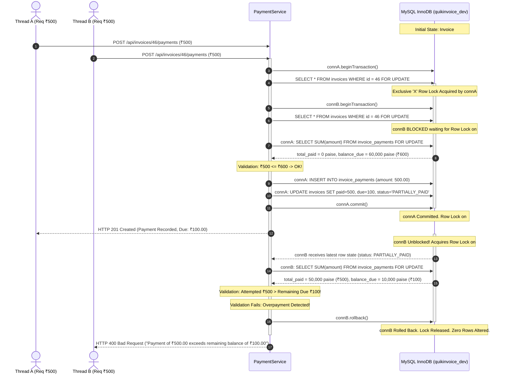

# QuikInvoice — Concurrency-Safe Payment Processing Deep Dive

**Document:** Payment Concurrency, Row-Level Locking, and Transactional Integrity  
**Target:** Engineering Interviewers, System Architects & Technical Auditors  
**Implementation File:** [`server/src/services/paymentService.js`](file:///Users/balajiaadesh/Desktop/projects/QuikInvoice/server/src/services/paymentService.js)  
**Test Suite:** [`server/tests/payment.test.js`](file:///Users/balajiaadesh/Desktop/projects/QuikInvoice/server/tests/payment.test.js)  
**Status:** Verified (86/86 Passing Automated Tests)  

---

## 1. The Core Problem: The Concurrent Overpayment Race Condition

In modern web applications, payment requests are frequently triggered concurrently. Real-world triggers include:
- A user double-clicking or rapidly clicking the "Pay Invoice" or "Confirm Payment" button.
- Multiple browser tabs open on the same invoice submitting payments simultaneously.
- Payment webhooks retried simultaneously by an automated payment processor gateway.
- Multiple accounting team members operating on the same business account at the same time.

### The Naive Architecture (Vulnerable to Overpayment)

Consider a traditional read-modify-write pattern without locking:

```
Thread A: Read invoice balance due (₹600.00)
Thread B: Read invoice balance due (₹600.00)  <-- Stale Read!
Thread A: Validate payment (₹500 <= ₹600) -> Valid!
Thread B: Validate payment (₹500 <= ₹600) -> Valid!
Thread A: Insert payment record (₹500.00)
Thread A: Update invoice amount_due = ₹100.00, amount_paid = ₹500.00
Thread B: Insert payment record (₹500.00)
Thread B: Update invoice amount_due = -₹400.00 (or ₹100.00 depending on calculation)
```

**Result:** The customer has paid ₹1,000.00 on a ₹600.00 invoice. The financial ledger is corrupted, business trust is compromised, and the ledger requires manual manual reconciliation or refund processing.

---

## 2. Why a Normal Balance Check Is Insufficient

A standard `SELECT amount_due FROM invoices WHERE id = ?` only guarantees read consistency at that specific instant in time. Under standard MySQL default isolation levels (`REPEATABLE READ`), non-locking `SELECT` statements use **Multi-Version Concurrency Control (MVCC)** snapshot reads.

This means:
1. Thread B will continue to see the snapshot of the row as it existed when its transaction began, completely unaware that Thread A is modifying or has modified the row.
2. Even in `READ COMMITTED`, checking the balance in memory and executing an `UPDATE` introduces a **Time-of-Check to Time-of-Use (TOCTOU)** gap. Any amount of time between the read query and the write query allows an interleaved operation to invalidate the assumption.

---

## 3. The Solution: MySQL InnoDB Pessimistic Row Locking (`SELECT ... FOR UPDATE`)

To guarantee strict ACID serializability at the row level without degrading throughput across unrelated invoices, QuikInvoice uses **pessimistic row-level exclusive locking** via MySQL InnoDB's `SELECT ... FOR UPDATE`.

### Sequence Diagram



---

## 4. Step-by-Step Implementation Breakdown

In [`server/src/services/paymentService.js`](file:///Users/balajiaadesh/Desktop/projects/QuikInvoice/server/src/services/paymentService.js):

### Step 1: Dedicated Connection Acquisition
```javascript
const connection = await pool.getConnection();
try {
  await connection.beginTransaction();
```
We acquire a dedicated connection from the connection pool so that all statements share the exact same transaction context and connection session.

### Step 2: Exclusive Row Lock with Multi-Tenant Guard
```javascript
const [invoiceRows] = await connection.query(
  'SELECT * FROM invoices WHERE id = ? AND user_id = ? FOR UPDATE',
  [invoiceId, userId]
);
```
- `FOR UPDATE` instructs InnoDB to place an **Exclusive (X) index row lock** on this specific invoice record.
- Because `user_id` is included in the query predicate, tenant isolation is verified simultaneously. If the invoice does not belong to the user, an immediate 404 is thrown without mutating state.
- Any concurrent transaction attempting `SELECT ... FOR UPDATE` or `UPDATE` on this row will block until this transaction commits or rolls back.

### Step 3: State Machine Validation
```javascript
if (invoice.status === 'DRAFT') {
  throw new BadRequestError('Cannot record payment against a DRAFT invoice.');
}
if (invoice.status === 'VOID') {
  throw new BadRequestError('Cannot record payment against a VOID invoice.');
}
if (invoice.status === 'PAID' || Number(invoice.amount_due) <= 0) {
  throw new BadRequestError('Invoice is already fully paid.');
}
```

### Step 4: Authoritative Balance Recalculation Inside Lock
```javascript
const [paySumRows] = await connection.query(
  'SELECT COALESCE(SUM(amount), 0) as total_paid FROM invoice_payments WHERE invoice_id = ? FOR UPDATE',
  [invoiceId]
);

const totalPaidCents = toCents(paySumRows[0].total_paid);
const totalAmountCents = toCents(invoice.total_amount);
const currentRemainingDueCents = Math.max(0, totalAmountCents - totalPaidCents);
```
Rather than trusting the cached column in `invoices.amount_paid`, the service re-sums all committed payments directly from the ledger table within the lock using integer paise arithmetic.

### Step 5: Overpayment Validation
```javascript
const validation = validatePaymentAmount(paymentData.amount, fromCents(currentRemainingDueCents));
if (!validation.valid) {
  throw new BadRequestError(validation.error);
}
```
If the payment exceeds the outstanding balance, an error is thrown. The catch block intercepts this and executes `await connection.rollback()`.

### Step 6: Atomic Insert, Update, and Commit
```javascript
await connection.query(
  `INSERT INTO invoice_payments (invoice_id, amount, payment_date, payment_method, reference, notes)
   VALUES (?, ?, ?, ?, ?, ?)`,
  [invoiceId, paymentAmountFormatted, paymentData.paymentDate, paymentData.paymentMethod, reference, notes]
);

const newPaidCents = totalPaidCents + paymentCents;
const newDueCents = Math.max(0, totalAmountCents - newPaidCents);
const newStatus = newDueCents === 0 ? 'PAID' : 'PARTIALLY_PAID';

await connection.query(
  `UPDATE invoices 
   SET amount_paid = ?, amount_due = ?, status = ?
   WHERE id = ? AND user_id = ?`,
  [fromCents(newPaidCents).toFixed(2), fromCents(newDueCents).toFixed(2), newStatus, invoiceId, userId]
);

await connection.commit();
```

---

## 5. Concrete Test Scenario & Empirical Verification

In [`server/tests/payment.test.js`](file:///Users/balajiaadesh/Desktop/projects/QuikInvoice/server/tests/payment.test.js):

### Tested Scenario:
- An invoice is created with total amount = ₹600.00.
- Three concurrent asynchronous requests are dispatched via `Promise.all`:
  - Request 1: ₹500.00
  - Request 2: ₹500.00
  - Request 3: ₹500.00

### Empirical Test Result:
```
✓ should prevent concurrent overpayment race conditions via row-level locking (SELECT ... FOR UPDATE) (980 ms)
```

**Outcome:**
1. Exactly one request succeeds with `201 Created`, updating `amount_paid = 500.00`, `amount_due = 100.00`, and `status = 'PARTIALLY_PAID'`.
2. The remaining two requests fail with `400 Bad Request`:
   `"Payment amount of ₹500.00 exceeds remaining balance of ₹100.00"`.
3. The database ledger contains exactly 1 payment record.
4. Total amount paid in the database remains ₹500.00 with ₹100.00 due. Zero overpayment occurs.

---

## 6. What This Guarantees vs Honest Scope Limitations

### What This Architecture Guarantees:
- **Serializability:** No two payments against the same invoice can execute concurrently.
- **Atomicity:** Payment insertion and invoice balance/status updates commit or rollback together.
- **Consistency:** Balance due cannot be driven below zero. Overpayments are rejected.
- **Isolation:** Uncommitted payments from other transactions are invisible.
- **Durability:** Committed payments are persisted in InnoDB write-ahead redo logs.

### Honest Architectural Boundaries:
- **Scope of Row Locks:** Row locks protect against race conditions within the same MySQL database instance.
- **Not Distributed Locks:** In a multi-region distributed active-active database setup, a distributed consensus lock (e.g. Redlock or ZooKeeper) or two-phase commit would be required.
- **Not Idempotency Keys:** While this mechanism prevents overpayment, if a client intends to submit two distinct ₹100 payments but submits the identical payload twice, both ₹100 payments will succeed if the balance permits. Implementing client-provided `Idempotency-Key` headers (with 24h key caching in Redis) represents a natural future enhancement.
